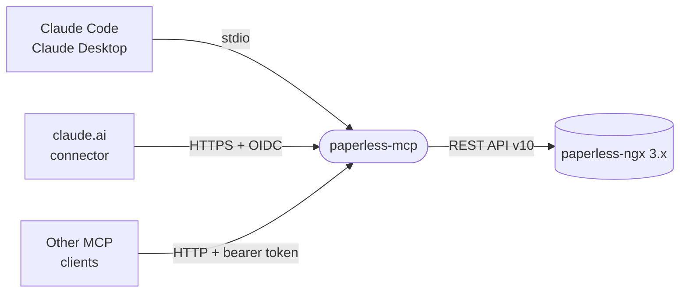

<div align="center">

# paperless-mcp

**Let Claude work with your [paperless-ngx](https://docs.paperless-ngx.com) archive:<br>
find, read, file, upload and organise documents by asking.**

[](https://github.com/gardenbaum/paperless-mcp/actions/workflows/ci.yml)
[](https://github.com/gardenbaum/paperless-mcp/actions/workflows/e2e-full.yml)
[](https://github.com/gardenbaum/paperless-mcp/pkgs/container/paperless-mcp)
[](https://github.com/paperless-ngx/paperless-ngx)
[](pyproject.toml)
[](LICENSE)

[Quick start](#quick-start) · [What you can ask](#what-you-can-ask) · [Toolsets](#toolsets) ·
[Safety](#how-it-keeps-your-archive-safe) · [Documentation](#documentation)

</div>

paperless-mcp is a [Model Context Protocol](https://modelcontextprotocol.io) server for
paperless-ngx 3.x, built on FastMCP 4. It gives Claude Code, Claude Desktop, claude.ai and any
other MCP client 87 tools in 13 toolsets that cover most of what the Paperless API can do, from a
search to mail rules and workflows. It starts small and careful: 18 tools by default, names instead
of ids, and a confirmation step before anything that cannot be undone.



## What you can ask

- "What is in my inbox? Suggest a correspondent, type and tags for each document and file them
  once I agree."
- "Find last year's electricity bills and add up what I paid."
- "Upload this PDF as an invoice from ACME and tag it tax-2026."
- "Which documents mention the rental deposit? Show me the paragraph."
- "Merge the three scans of the contract into one document and rotate page 2."
- "Give me a link to my insurance policy that expires in a week."
- "Set up a mail rule that files the invoices from billing@example.org."
- "Find duplicate and unused tags and propose how to clean them up."

An example of how that goes (illustrative):

> **You:** What is still in my inbox?
>
> **Claude:** Three documents. Here is how I would file them:
>
> | Document | Correspondent | Type | Tags |
> |---|---|---|---|
> | Electricity bill, March | City Power | Invoice | utilities, tax-2026 |
> | Policy update | Northwind Insurance | Letter | insurance |
> | Receipt, hardware store | *new:* Brick & Bolt | Receipt | household |
>
> "Brick & Bolt" does not exist yet as a correspondent; I would create it. Shall I apply this?
>
> **You:** Yes, and tag the policy update tax-2026 too.

Four built-in prompts start such tasks from the client's prompt menu: `triage_inbox`,
`find_document`, `annual_review` and `cleanup_taxonomy`. Each one proposes its changes and waits
for your yes before it writes.

## Why another paperless-ngx MCP server?

There are already several MCP servers for paperless-ngx. This one is a new build, made for
people who want all of the following in one server:

- 🗂️ **Much more than search.** Besides finding, reading and filing documents it handles notes,
  custom fields, saved views, file versions, the trash, PDF operations, share links, mail rules,
  workflows, permissions and user administration: most of what paperless-ngx 3.x can do.
- 🏷️ **Names instead of numbers.** You say "invoices from ACME tagged tax-2026" and the server
  finds the matching ids itself. If a name does not exist or fits more than one entry, it says so
  and lists the candidates instead of guessing.
- 🛡️ **Nothing final without your yes.** Before a tool deletes, overwrites, publishes or shares
  anything, it reports what would happen and waits for your confirmation. Changes to many
  documents at once can be previewed first.
- 🪶 **Small to start with.** Only 18 tools by default out of the 87, so the assistant starts
  with the essentials and you decide what else it may do. Search results are short lists and long
  documents are read piece by piece, so a conversation does not fill up with text it does not
  need.
- 🧪 **Tested against a real Paperless.** More than 600 tests run against a real paperless-ngx
  after every change and every night, on top of more than 4,500 faster tests. Every week the
  whole suite also runs against the newest Paperless release.
- 🔐 **Safe to reach from outside.** Over the network the server does not start without
  authentication. Claude Code signs in with a token, claude.ai through your own identity
  provider, and the container image runs without root rights.

## Quick start

You need a Paperless API token: in Paperless open your profile menu, "My Profile", and create an
API auth token. The server acts as that user and sees and changes only what that user may.

### Claude Code

With [uv](https://docs.astral.sh/uv/) installed, one command, no clone:

```sh
claude mcp add paperless \
    --env PAPERLESS_URL=https://paperless.example.org \
    --env PAPERLESS_TOKEN=your-api-token \
    -- uvx --from git+https://github.com/gardenbaum/paperless-mcp paperless-mcp
```

Add `--scope user` to have it in every project. Then ask Claude for an overview of your Paperless
instance. To stay on a release, append its tag to the URL (`...paperless-mcp@v0.1.0`).

### Claude Desktop

Add the server to `claude_desktop_config.json` (Settings, Developer, Edit Config) and restart:

```json
{
  "mcpServers": {
    "paperless": {
      "command": "uvx",
      "args": ["--from", "git+https://github.com/gardenbaum/paperless-mcp", "paperless-mcp"],
      "env": {
        "PAPERLESS_URL": "https://paperless.example.org",
        "PAPERLESS_TOKEN": "your-api-token"
      }
    }
  }
}
```

If Claude Desktop cannot find `uvx`, give its full path (`which uvx`). Other MCP clients that
start a stdio server take the same command, arguments and environment.

### Container, for remote clients

The image serves MCP over Streamable HTTP and does not start without authentication:

```sh
export MCP_TOKEN="$(openssl rand -hex 32)"
docker run -d --name paperless-mcp -p 127.0.0.1:8001:8000 \
    -e PAPERLESS_URL=https://paperless.example.org \
    -e PAPERLESS_TOKEN=your-api-token \
    -e PAPERLESS_MCP_HTTP_AUTH_TOKENS="$MCP_TOKEN" \
    -e PAPERLESS_MCP_HTTP_ALLOWED_HOSTS=localhost \
    ghcr.io/gardenbaum/paperless-mcp:0.1.0

claude mcp add --transport http paperless http://127.0.0.1:8001/mcp \
    --header "Authorization: Bearer $MCP_TOKEN"
```

[Run in a container](docs/container.md) has the compose file next to Paperless and the reverse
proxy setup, [Run over HTTP](docs/http.md) the details of the transport.

### claude.ai

claude.ai custom connectors sign in with OAuth. Put the HTTP server behind your identity provider
(Authentik, Keycloak, Google, Auth0 or any other OpenID Connect provider) with five environment
variables: [Connect claude.ai](docs/claude-ai-connector.md).

## Toolsets

The 87 tools are grouped into toolsets, and only two are on by default, so the model is not
handed tools you never use. Switch more on with `PAPERLESS_MCP_TOOLSETS=core,ai,pdf,trash` or
`all`.

| Toolset | Tools | Default | What it is for |
|---|---|---|---|
| `core` | 16 | on | Search, read, download, file and upload documents; notes; tags, correspondents, types, storage paths and custom fields; background tasks |
| `ai` | 2 | on | Ask Paperless AI about your documents and get its filing suggestions (offered only while Paperless AI is enabled) |
| `bulk` | 2 | | Change many documents or taxonomy items in one step, with a dry run first |
| `pdf` | 7 | | Rotate, merge, split, delete pages, edit PDFs, remove passwords, reprocess |
| `versions` | 5 | | The file versions of a document: list, upload, label, delete, merge documents as versions |
| `trash` | 3 | | List the trash, restore from it, empty it |
| `views` | 6 | | Saved views: create, change, delete and run them |
| `sharing` | 8 | | Public share links and bundles, and sending documents by e-mail |
| `permissions` | 3 | | Owners and view and change rights of documents and taxonomy; list users and groups |
| `mail` | 13 | | Mail accounts and rules for the mail import, and what it processed |
| `workflows` | 5 | | The workflows Paperless runs by itself: triggers and actions |
| `admin` | 16 | | Users, groups, application configuration, logs, tasks, bulk download |
| `raw` | 1 | | A read-only escape hatch: GET any path of the Paperless API the other tools do not cover |

Every tool with its kind and a one-line description is in the [tool
reference](docs/tools.md); what to know before switching a toolset on is in
[Configuration](docs/configuration.md#toolsets).

## How it keeps your archive safe

An assistant that can file your documents can also delete them. The server is built so that this
takes more than a misunderstanding:

- **Confirmation before anything final.** Tools that delete, overwrite, publish or grant access
  change nothing when called without `confirm=true`. They answer with what would happen (which
  documents, who gains access, what cannot be undone), so the client shows it to you first.
- **Dry runs for bulk edits.** `bulk_edit_documents` and `bulk_edit_taxonomy` preview how many
  objects would change before they ask for confirmation.
- **The trash first.** Deleting a document moves it to the Paperless trash, from where it can be
  restored. Emptying the trash is a separate tool in a toolset that is off by default.
- **You choose the surface.** Toolsets are opt-in, `PAPERLESS_MCP_READ_ONLY=true` offers only
  tools that change nothing, and `PAPERLESS_MCP_DISABLED_TOOLS` takes single tools away.
- **Paperless stays in charge.** The server acts as the user of its API token: the permissions
  set in Paperless apply to every call.
- **Secrets stay secret.** Passwords and API keys are write-only, and tokens, document text and
  search queries are not logged at the default log level.
- **No reach beyond Paperless.** Callers cannot make the server read local files or reach other
  hosts. Uploading by file path exists only over stdio and only from directories you name.

## Configuration

The settings you are most likely to touch; [Configuration](docs/configuration.md) has all of
them.

| Variable | Meaning |
|---|---|
| `PAPERLESS_URL` | Base URL of your Paperless instance (required) |
| `PAPERLESS_TOKEN` | Paperless API token (required) |
| `PAPERLESS_PUBLIC_URL` | Base URL for links shown to you, if it differs from `PAPERLESS_URL` |
| `PAPERLESS_MCP_TOOLSETS` | Toolsets to offer, comma-separated, or `all` (default `core,ai`) |
| `PAPERLESS_MCP_READ_ONLY` | `true` to offer only tools that change nothing |
| `PAPERLESS_MCP_DISABLED_TOOLS` | Tools never offered, by name |
| `PAPERLESS_MCP_UPLOAD_DIRS` | Directories the model may upload files from by path (stdio only; default: none) |

## Compatibility

| | |
|---|---|
| **paperless-ngx** | 3.4.2 and later (API version 10). Every change is tested against 3.4.2, the latest 3.x release weekly. 2.x is not supported |
| **Clients** | Claude Code and Claude Desktop over stdio, claude.ai custom connectors and other MCP clients over Streamable HTTP |
| **Runtime** | Python 3.14 or later (`uvx` fetches it for you), or the container image |

## Documentation

- [Configuration](docs/configuration.md): every variable, the toolsets, read-only mode, uploads
- [Tool reference](docs/tools.md): all tools and prompts
- [Run over HTTP](docs/http.md): bearer tokens, allowed hosts, what the transport refuses
- [Connect claude.ai](docs/claude-ai-connector.md): sign-in through your identity provider
- [Run in a container](docs/container.md): the image, compose files, reverse proxy
- [Development](docs/development.md): architecture, how it is tested, how to contribute

## Known limitations

- **One Paperless user per server.** Every client of a server acts as the user of its
  `PAPERLESS_TOKEN`, also when clients sign in through an identity provider. Run one server per
  Paperless account.
- **`search_documents` with `more_like_id` can return nothing on Paperless 3.4.2.** Paperless
  3.4.2 (Tantivy 0.26) panics while scoring a more-like-this query once edited or deleted
  documents have left stale entries in the search index. Paperless catches the panic, logs
  `More Like This scoring panicked` and answers an empty list with HTTP 200, so the server cannot
  tell it from "no similar documents". If a result is empty although similar documents should
  exist, have an administrator run `document_index reindex` in the Paperless container (for
  example `docker compose exec webserver document_index reindex`). The fix is upstream in Tantivy
  (tantivy PR 2964); it needs a Paperless release that ships it.

## How this project is built

The code is written by AI agents and held to rules that are checked, not remembered: a layered
architecture enforced by import contracts, every design decision recorded with the test that
guards it (`backlog/decisions/`), a contract suite that runs the same tests against a fake and a
real Paperless, and mutation testing with a gate. Plans and task history are in `backlog/`. See
[Development](docs/development.md) to run the checks yourself; issues and pull requests are
welcome.

## Credits

This is a new build, not a fork, but it learned from three existing paperless-ngx MCP servers and
adopts some of their ideas deliberately:

- [pvliesdonk/paperless-mcp](https://github.com/pvliesdonk/paperless-mcp) (MIT): field
  projection in lists, content slicing with a next offset, retries only for idempotent calls,
  token redaction, errors that name the next call, a central tool-annotation table, `web_url`,
  and the OIDC proxy beside bearer tokens.
- [baruchiro/paperless-mcp](https://github.com/baruchiro/paperless-mcp) (ISC): names instead of
  IDs in output, `confirm: true` for destructive calls, an upload allowlist, live end-to-end tests
  against a real Paperless, a test over every advertised tool schema.
- [OrellBuehler/paperless-mcp](https://github.com/OrellBuehler/paperless-mcp) (MIT): toolsets,
  a read-only mode and a test that every tool belongs to a toolset, coverage of Paperless 3.x
  features (versions, AI suggestions, trash, PDF operations), prompts that ask for confirmation,
  a test that every tool named in a prompt exists.

Thanks to the [paperless-ngx](https://github.com/paperless-ngx/paperless-ngx) and
[FastMCP](https://github.com/PrefectHQ/fastmcp) projects, which this server stands on.

## Licence

MIT, see [LICENSE](LICENSE).

---

<div align="center">

If paperless-mcp saves you time, a ⭐ helps other Paperless users find it.

</div>
